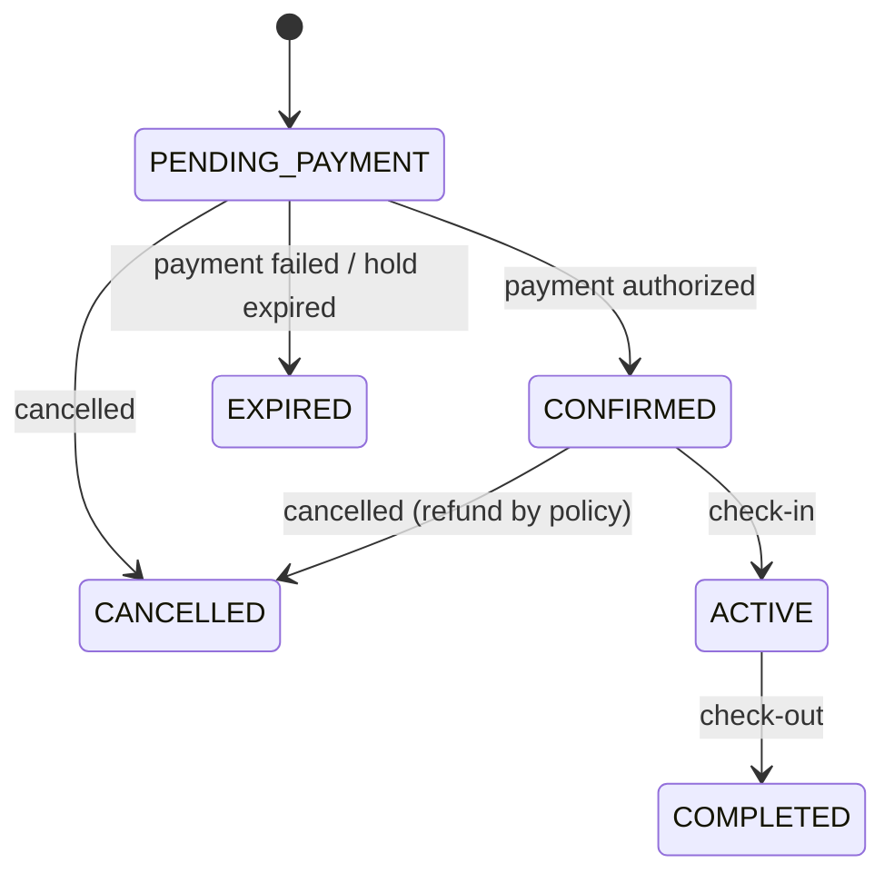
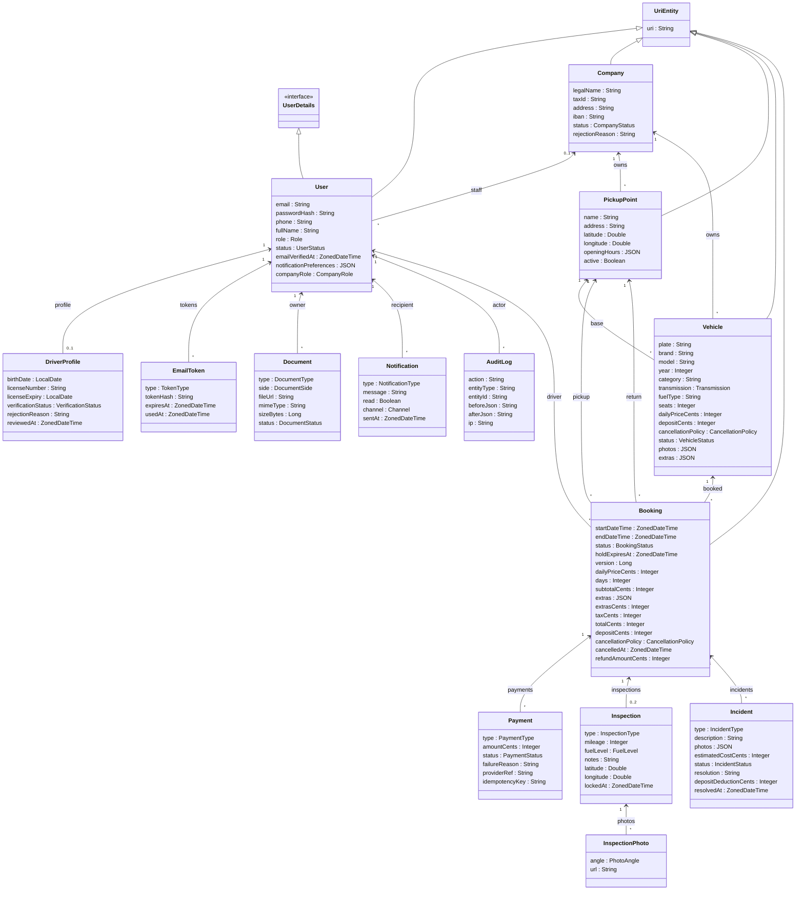

# PickCar
 
> **Pick it, drive it.**
 
Car rental platform that connects drivers with rental companies, built with Spring Boot (REST API, HATEOAS, JPA) and React. Additional details: [HELP.md](HELP.md)

## Vision
 
**For** drivers who need a car for a few days and rental companies that want to reach more customers
**who** want to rent and offer vehicles with verified users, transparent prices and a documented handover
**the project** is PickCar, a car rental platform with three roles (Driver, Company, Admin)
**that** covers the whole rental end to end: manual identity verification, availability without overlaps, payment with deposit, cancellation with refund rules, check-in and check-out with photos, and incident handling
**Unlike** a simple vehicle listing site, every booking is traceable and protected by business rules, and development is driven by BDD (Cucumber) tests

## Features per Stakeholder
 
| DRIVER                                   | COMPANY                                          | ADMIN                                      |
|------------------------------------------|--------------------------------------------------|--------------------------------------------|
| Register and verify email                | Register company                                 | Login                                      |
| Login, recover password                  | Login, recover password                          | Approve / reject drivers                   |
| Upload licence (front and back)          | Upload CIF and insurance documents               | Approve / reject companies                 |
| Search vehicles                          | Manage vehicles (add, edit, pause, retire)       | Approve / reject vehicles                  |
| Book and pay (price breakdown, deposit)  | Manage pickup points and extras                  | Resolve incidents and decide on deposit    |
| Cancel booking (refund by policy)        | Cancel a booking (full refund to the driver)     | View audit log                             |
| Check-in and check-out                   | Report incidents                                 |                                            |
| Report incidents                         | Receive notifications                            |                                            |
| Receive notifications and set preferences|                                                  |                                            |
 
Company users have a company role (`OWNER`, `FLEET_MANAGER`, `AGENT`, `ACCOUNTANT`) that decides what they can do inside their company.

## Booking Lifecycle
 

## Entities Model

## Features
 
The behaviour of the platform is defined in Cucumber feature files:
 
| Feature file                  | Covers                                                |
|-------------------------------|-------------------------------------------------------|
| `driver_registration.feature` | Registration, email verification, document upload     |
| `authentication.feature`      | Login, logout, password recovery, access control      |
| `vehicle_search.feature`      | Search, filters, availability rules                   |
| `booking.feature`             | Price breakdown, payment, temporary hold, overlaps    |
| `cancellation.feature`        | Refund by policy and timing                           |
| `inspection.feature`          | Check-in and check-out                                |
| `incident.feature`            | Incidents, deposit retention and resolution           |
| `company_fleet.feature`       | Company registration, vehicles, pickup points         |
| `admin_verification.feature`  | Manual review of drivers, companies, vehicles; audit  |
| `notifications.feature`       | Notifications and preferences                         |

## AI-Assisted Spec-Driven Development (SDD)

This repository serves as a starter template for **AI-Assisted Spec-Driven Development (SDD)** with **Spring Data REST** and **Cucumber BDD**.

It is pre-configured with agent skills (`skills/`), repository instructions (`AGENTS.md`, `CONVENTIONS.md`), and Aider configuration (`.aider.conf.yml`) to support both:
1. **Full-Capability AI Agents** (OpenCode, Claude Code, Cursor, GitHub Copilot, Windsurf).
2. **Token-Constrained APIs** (Aider paired with Groq free tier - 8K token limits).

For complete stage-by-stage instructions and command workflows, see **[AI_DEVELOPMENT_GUIDE.md](AI_DEVELOPMENT_GUIDE.md)**.

### SDD Agent Skills (`skills/`)
- **`skills/sdd-feature-designer/SKILL.md`**: Draft Cucumber `.feature` specs for Spring Data REST endpoints (<50 lines).
- **`skills/sdd-cucumber-steps/SKILL.md`**: Implement MockMvc step definition classes extending `StepDefs.java`.
- **`skills/spring-datarest-entity/SKILL.md`**: Create JPA `@Entity` classes extending `UriEntity` and `@RepositoryRestResource` interfaces with SpEL row-level security queries.
- **`skills/spring-datarest-hander/SKILL.md`**: Create lifecycle event handlers based on the `@RepositoryEventHandler`.
- **`skills/sdd-bdd-verifier/SKILL.md`**: Run `mvn test -Dtest=CucumberTest` and analyze test failure summaries.
